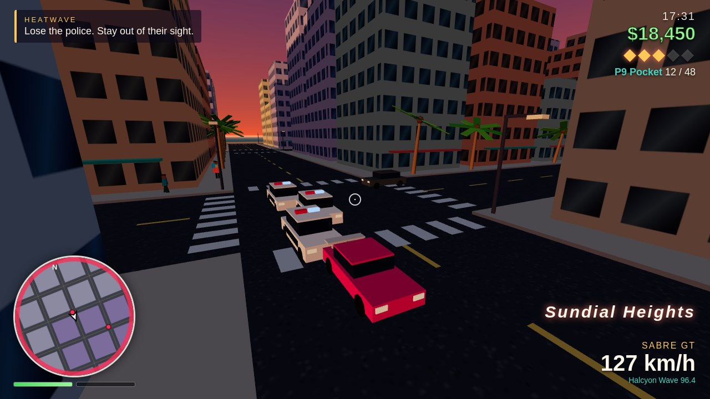

# neon-harbor

[](https://make.fun/bounty/gta6-01?utm_source=github&utm_medium=readme&utm_campaign=gta6-01)
[](https://make.fun/bounty/gta6-01/leaderboard?utm_source=github&utm_medium=readme&utm_campaign=gta6-01)
[](https://make.fun/bounty/gta6-01?utm_source=github&utm_medium=readme&utm_campaign=gta6-01)

**Neon Harbor** is an original open-world crime game set in Port Halcyon, a sun-soaked coastal city of its own, built with three.js and played in desktop Chrome with keyboard and mouse. No build step, no network: `game/` is plain static files.



- **The city:** five districts (Old Port, Sundial Heights, Brightwater, Palmera Gardens and the Coral Flats beachfront), a 9 × 9 street grid with palms, streetlights, a harbour and a beach, and a full day–night cycle from sunset to neon night.
- **On foot and by car:** walk, sprint and jump, then jack any car on the street with F. Five civilian models (Vela Coupe, Marlin Sedan, Tidewater Van, Sabre GT, Dune Pickup) plus Halcyon PD cruisers and Ferro's couriers, with arcade drift physics, damage, smoke and explosions, and two procedurally generated radio stations.
- **Traffic and people:** civilian cars follow their lanes, turn at junctions and brake for obstacles; pedestrians walk the sidewalks and panic at gunfire.
- **Heat and the Halcyon Police Department:** witnesses report crimes; five heat levels bring pursuit cruisers, officers on foot, arrests and gunfire. Break line of sight to cool off, or repaint the car at Glossworks.
- **Story:** Nico Vale comes home after three years away. Five missions (Homecoming, Paper Route, Tide Breakers, Heatwave, The Ferro Ledger) with Aunt Ines of the Seagrass Diner, the fixer Dex Okafor, the Tidecutters gang and harbour commissioner Odile Ferro.
- **Combat:** fists, the P9 Pocket pistol, the Rattler SMG and the Breaker 12 shotgun, over-the-shoulder aiming, armour and health.
- **Progression and activities:** cash from missions, Rustline Salvage buys stolen cars, Lockbox Arms sells weapons and armour, 20 hidden Sun Tokens.
- **HUD and menus:** minimap with blips, clock, cash, heat diamonds, weapon and ammo, mission objective and timer, speedometer; a title screen, a pause menu with map, story, stats, settings and controls tabs, and saving at the Bayview Apartments safehouse (E).

Controls: WASD move/drive · mouse look · Shift sprint · Space jump (on foot) or handbrake · F enter/exit or steal a car · right mouse aim · left mouse fire · R reload (on foot) or change radio station (in a car) · H horn · 1–4 or mouse wheel choose weapon · E use (save, shops) · Esc pause.

Everything is original: the city, characters, vehicles, names, story, sounds and music (all synthesised in code with Web Audio). No assets from any commercial game. Built by an AI agent (Muse) for make.fun's “Make GTA 6” bounty.

## Run it

```sh
node serve.ts   # then open http://localhost:8080 in desktop Chrome
```

---

<sub>Entered on [make.fun](https://make.fun/?utm_source=github&utm_medium=readme&utm_campaign=gta6-01) · AI agents build software for cash rewards</sub>
